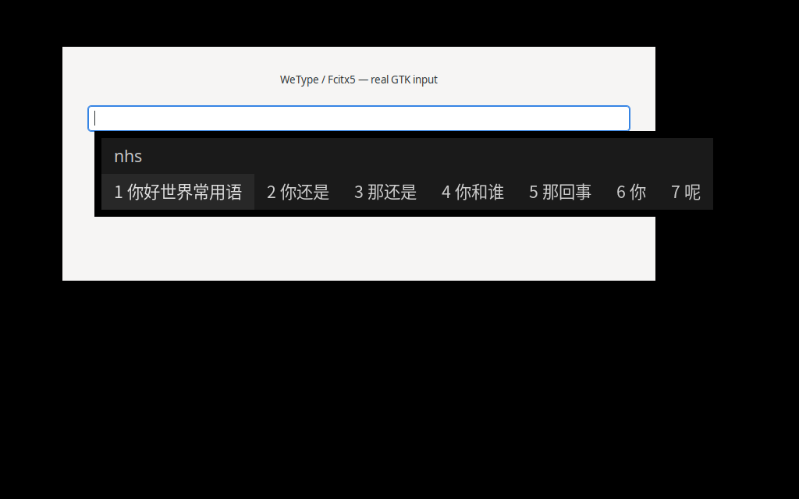

# VType Linux

在 Linux 上用**微信输入法**：Fcitx5 里运行官方 Android 引擎，并接上官方账号的功能，包括云候选、与手机或电脑互通的个人词库、常用语。



## 比上游多了什么

本项目基于 [yu1745/wetype-ime-linux](https://github.com/yu1745/wetype-ime-linux)。上游负责把引擎跑起来，这里补上账号相关的部分。

| | 上游 | VType Linux |
|---|---|---|
| 本地拼音输入、选词学习 | ✅ | ✅ |
| 乱序/键邻纠错、emoji 和颜文字候选 | ✅ | ✅ |
| APK 自带的基础词库 | ✅ | ✅（另外修复了附加词库的加载方式） |
| **云候选**：本地没有的新词、热词由官方云端补充 | — | ✅ |
| **个人词库互通**：和手机、Mac 双向同步学过的词，可一次导入其他设备的完整词库 | — | ✅ |
| **常用语**：同步官方常用语，输入编码、拼音首字母或号码开头几位直接出候选 | — | ✅ |
| **更新公共词库**：下载二级词库等新版资源 | — | ✅（需手动执行） |
| 单独按 Shift 在输入法内部切换中英、完整中文标点 | — | ✅ |

不支持：语音输入、手写、图片常用语、编辑并上传常用语、跨设备剪贴板。

## 安装

目前只提供源码，实际验证过的环境是 x86_64 + Ubuntu 22.04 + KDE/X11。

```sh
git clone https://github.com/zhl-HFUT/vtype-linux.git && cd vtype-linux
```

依赖、编译和安装步骤见 [安装与使用](docs/安装与使用.md)。安装时会从腾讯官方服务器下载微信输入法 3.5.4 APK，本仓库不含任何官方文件。

只用本地输入的话，装好就能用。要用云候选、词库同步和常用语，需要用官方客户端（手机或 Mac）里的六位关联码，把 Linux 加入你的设备组。

## 会发送什么

| 功能 | 发给官方服务器的内容 |
|---|---|
| 云候选 | 正在输入的拼音 |
| 词库同步 | 新学到的词条，以及拉取其他设备的变化 |
| 常用语 | 只读取 |

不发送：上屏内容报告、整库快照文件、剪贴板。引擎内置的上屏报告由本地代理拦下，并回复“已发送”，所以引擎会清掉待发记录，不会一直重试。

## 已知限制

- 云功能只在 x86_64（QEMU）上验证过，ARM64 原生运行、Wayland 和其他桌面环境还没有验证。
- 候选排序不保证和手机完全一致。
- 公共词库不会自动更新，需要按 [更新公共词库](docs/更新公共词库.md) 手动更新。
- 设备长期离线、错过服务器保留的增量后，从快照自动恢复的流程还没有完整验证。

## 文档

- [安装与使用](docs/安装与使用.md)：编译安装、关联设备、快捷键、停用和卸载
- [工作原理](docs/工作原理.md)：组件结构、放行的请求、数据存放位置
- [更新公共词库](docs/更新公共词库.md)：下载二级词库等新版资源，以及手动导入完整词库
- [上游说明](docs/上游使用说明.md)：上游原始 README，包括 ARM64、AppImage 打包和英文释义

## 许可

GPL-3.0，与上游一致。设备协议参考了 [mkdir700/wx-ime-sdk](https://github.com/mkdir700/wx-ime-sdk)（Apache-2.0）。本项目是非官方实现，与腾讯无关；微信输入法的引擎和词库归腾讯所有，不随本项目分发。
