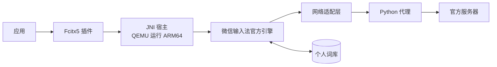

# 工作原理

- **Fcitx5 插件**：负责按键、候选窗、中英切换、标点和常用语候选。
- **JNI 宿主**：模拟 Android 环境，把官方引擎（`libwxhld.so`）跑起来。安卓版里 Java 层负责的事情（账号、网络、文件下载），由宿主和 Python 代理补上。
- **官方引擎**：生成候选，保存学习结果，执行同步和词库合并。词库合并完全使用官方逻辑，本项目没有另写一套。
- **Python 代理**：替引擎联网。它复用关联时生成的设备身份，只放行已经核对过的请求。

## 代理放行的请求

| 请求 | 用途 | 处理 |
|---|---|---|
| 4329/2 | 云候选 | 联网 |
| 4814/34 | 设备组信息、常用语（不含剪贴板） | 联网，只读 |
| 4814/41、42 | 上传本机新学的词、拉取其他设备的变化 | 联网，检查账号、组号和单次条数 |
| 4814/44、60 | 查询快照、申请快照下载凭证 | 联网，只用于下载 |
| 4814/43 | 向设备组上报本机的全量状态 | 不联网，本地回复成功 |
| 4814/91 | 上屏内容报告 | 不联网，本地回复成功 |
| 其他 | 未核对的请求 | 拒绝 |

43 和 91 如果直接拒绝，引擎会不断重试；91 的待发队列（最多 100 条上屏内容）也会一直留在词库里。所以改为本地回复成功：引擎认为已经发送，就会清掉队列。

整库快照只下载、不上传。下载由代理用 HTTPS 完成，只接受腾讯云 COS 的地址，文件写进引擎的工作目录后，再通知引擎导入。

## 云候选响应时限

云功能启用时，通过官方 `InitInfo.exptInfo` 配置将引擎的云响应有效期设为 1500ms。本地候选仍立即返回，云结果异步补入；输入已变化或已经选词的旧结果会被丢弃。关闭云功能时使用引擎默认值。

可在 `cloud.json` 中设置整数 `cloud_timeout_ms`，范围 200–5000。它控制引擎接收结果的有效期，网络请求本身仍受代理的 1.2 秒超时限制。配置在下次启动引擎时生效。

## 同步节奏

- 词库同步由引擎在你打字时触发：拉取最多约 10 分钟一次，上传大约 1 分钟一次。冲突由官方引擎处理。
- 每 5 分钟的定时任务只做三件事：续期登录、刷新设备组信息、更新常用语缓存。
- 设备组的开关和组号变化，要等输入法重启后才生效。

## 剪贴板同步

剪贴板由独立的用户进程运行，默认关闭，不通过输入引擎的网络代理。显式启用后，读取系统 CLIPBOARD 的纯文本变化，每 5 秒用 `4814/34` 的过滤位 `3` 查询设备组及最新剪贴板，用 `4814/36` 发送新复制的文本。设备组和来源必须有效，接收消息还须满足版本及服务器过期时间要求。

它复用关联身份和现有加密传输，只在读取身份时持有身份锁，五分钟刷新任务未运行时自己续期登录。没有直接用常驻 wxc：wxc 运行期间独占身份锁，而且其接收命令在写入系统剪贴板之前就推进了游标。系统剪贴板写入成功后才保存接收游标；接收文字不会回传。发送前保存不含文本的发送标识，遇到结果不明只核对远端，不自动重发。不请求 COS 上传凭证，不发送图片或文件。配置与操作说明见[剪贴板互通](剪贴板互通.md)。

## 文件位置

| 内容 | 位置 |
|---|---|
| 设备身份 | `~/.local/state/wetype-ime/account`（可用 `$WETYPE_STATE_DIR` 修改） |
| 个人词库、常用语缓存 | `~/.local/share/wetype-ime` |
| 云功能配置 | `~/.config/wetype-ime/cloud.json` |
| 剪贴板开关及后端 | `~/.config/wetype-ime/clipboard.json` |
| 剪贴板游标和运行统计（不含文本） | 身份目录下的 `clipboard-state.json`、`clipboard-status.json` |
| 引擎日志 | `~/.local/state/wetype-ime/harness.log`（可能包含输入内容） |
| 请求统计 | 身份目录下的 `native-sync-live/requests.jsonl`（只记录请求类型和大小，不记录内容） |
