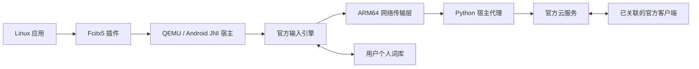

# 架构与限制

Fcitx 插件处理按键、界面、输入版本与候选选择序号。JNI 宿主提供 Android 环境；官方引擎生成候选、保存学习、应用官方同步记录，并解密和合并快照。宿主不自行重写词库合并规则。

云候选使用独立 SEQPACKET 通道，取消过期查询，晚到结果不覆盖新输入。词库同步使用分帧 stream 通道，避免较大同步响应超出单个数据报限制。COS 下载为独立文件传输回调；文件落盘后通知官方引擎继续处理。

## 已开放请求

| 请求 | 用途 |
| --- | --- |
| 4329/2 | 普通拼音云候选 |
| 4814/34 | 设备组、文本常用语和清理记录拉取；不含剪贴板位 |
| 4814/41、42 | 新学习的增量上传与增量下载 |
| 4814/44 | 全量快照元数据 |
| 4814/60 | 开启下载时，仅本身份/本组已知快照所需凭证查询 |

43 全量状态写入、91 上屏报告及其他未核对请求保持拒绝。JNI 中整库文件上传任务异步失败，不发送文件；避免未实现的上传阻塞官方串行队列。凭证查询不等于文件上传。

## 同步行为

原生词库同步随输入会话检查，受官方引擎持久限流影响，实际拉取最多约每10分钟一次；不是五分钟 timer 拉词库。冲突由官方引擎处理。五分钟任务只握手、查组信息和更新常用语缓存。

常用语保存编码是权威值。桥接将命中的文本常用语加入候选，保存原生候选序号映射，避免插入候选后选错词。该宿主行为不保证复刻官方所有推荐与置顶策略。

快照传输与合并已验证；长期离线后请求其他设备重新发布快照的完整自动恢复流程尚未验证。高级补拉工具只在私有副本运行，不能直接替换正式词库。

## 私有文件

- 身份与协议状态：`~/.local/state/wetype-ime/account`，或 `$WETYPE_STATE_DIR`。
- 个人词库和常用语缓存：`~/.local/share/wetype-ime`，或 `$XDG_DATA_HOME/wetype-ime`。
- 云配置：`~/.config/wetype-ime/cloud.json`，或 `$XDG_CONFIG_HOME/wetype-ime/cloud.json`。
- 引擎日志：默认 `~/.local/state/wetype-ime/harness.log`，可能包含输入与候选；报告问题时不要直接上传。

协议统计不保存词条内容或签名下载地址。快照工具的工作目录仍含个人词库，不能用于公开示例或上传 Issue。关闭上屏报告不等于完全离线：启用云候选会发送当前拼音查询，启用同步会传送学习词条。
